# ID Change Log

- Run at: 2026-11-12T20:24:23.855Z
- Bundle: https://bloxd.io/static/js/j3ktyq.main.3c8c7aed.js
- Entries: 9602 -> 10080

ID changed (1492)

-  Wood Pickaxe (item): 8110 -> **8548**
-  Stone Pickaxe (item): 8111 -> **8549**
-  Iron Pickaxe (item): 8112 -> **8550**
-  Gold Pickaxe (item): 8113 -> **8551**
-  Diamond Pickaxe (item): 8114 -> **8552**
-  Moonstone Pickaxe (item): 8115 -> **8553**
-  Golem Pickaxe (item): 8116 -> **8554**
-  Wood Axe (item): 8117 -> **8555**
-  Stone Axe (item): 8118 -> **8556**
-  Iron Axe (item): 8119 -> **8557**
-  Gold Axe (item): 8120 -> **8558**
-  Diamond Axe (item): 8121 -> **8559**
-  Moonstone Axe (item): 8122 -> **8560**
-  Artisan Axe (item): 8123 -> **8561**
-  Wood Spade (item): 8124 -> **8562**
-  Stone Spade (item): 8125 -> **8563**
-  Iron Spade (item): 8126 -> **8564**
-  Gold Spade (item): 8127 -> **8565**
-  Diamond Spade (item): 8128 -> **8566**
-  Wood Sword (item): 8129 -> **8567**
-  Stone Sword (item): 8130 -> **8568**
-  Iron Sword (item): 8131 -> **8569**
-  Gold Sword (item): 8132 -> **8570**
-  Diamond Sword (item): 8133 -> **8571**
-  Knight Sword (item): 8134 -> **8572**
-  Wood Hoe (item): 8135 -> **8573**
-  Stone Hoe (item): 8136 -> **8574**
-  Iron Hoe (item): 8137 -> **8575**
-  Gold Hoe (item): 8138 -> **8576**
-  Diamond Hoe (item): 8139 -> **8577**
-  Flashlight (item): 8140 -> **8578**
-  Mining Helmet (item): 8141 -> **8579**
-  Wood Helmet (item): 8142 -> **8580**
-  Iron Helmet (item): 8143 -> **8581**
-  Gold Helmet (item): 8144 -> **8582**
-  Diamond Helmet (item): 8145 -> **8583**
-  Wood Chestplate (item): 8146 -> **8584**
-  Iron Chestplate (item): 8147 -> **8585**
-  Gold Chestplate (item): 8148 -> **8586**
-  Diamond Chestplate (item): 8149 -> **8587**
-  Fur Chestplate (item): 8150 -> **8588**
-  Wood Leggings (item): 8151 -> **8589**
-  Iron Leggings (item): 8152 -> **8590**
-  Gold Leggings (item): 8153 -> **8591**
-  Diamond Leggings (item): 8154 -> **8592**
-  Wood Boots (item): 8155 -> **8593**
-  Iron Boots (item): 8156 -> **8594**
-  Gold Boots (item): 8157 -> **8595**
-  Diamond Boots (item): 8158 -> **8596**
-  Spiked Boots (item): 8159 -> **8597**
-  Wood Gauntlets (item): 8160 -> **8598**
-  Iron Gauntlets (item): 8161 -> **8599**
-  Gold Gauntlets (item): 8162 -> **8600**
-  Diamond Gauntlets (item): 8163 -> **8601**
-  Military Helmet (item): 8164 -> **8602**
-  Military Chestplate (item): 8165 -> **8603**
-  Military Gauntlets (item): 8166 -> **8604**
-  Military Leggings (item): 8167 -> **8605**
-  Military Boots (item): 8168 -> **8606**
-  White Wood Helmet (item): 8169 -> **8607**
-  White Wood Chestplate (item): 8170 -> **8608**
-  White Wood Leggings (item): 8171 -> **8609**
-  White Wood Boots (item): 8172 -> **8610**
-  White Wood Gauntlets (item): 8173 -> **8611**
-  Orange Wood Helmet (item): 8174 -> **8612**
-  Orange Wood Chestplate (item): 8175 -> **8613**
-  Orange Wood Leggings (item): 8176 -> **8614**
-  Orange Wood Boots (item): 8177 -> **8615**
-  Orange Wood Gauntlets (item): 8178 -> **8616**
-  Magenta Wood Helmet (item): 8179 -> **8617**
-  Magenta Wood Chestplate (item): 8180 -> **8618**
-  Magenta Wood Leggings (item): 8181 -> **8619**
-  Magenta Wood Boots (item): 8182 -> **8620**
-  Magenta Wood Gauntlets (item): 8183 -> **8621**
-  Light Blue Wood Helmet (item): 8184 -> **8622**
-  Light Blue Wood Chestplate (item): 8185 -> **8623**
-  Light Blue Wood Leggings (item): 8186 -> **8624**
-  Light Blue Wood Boots (item): 8187 -> **8625**
-  Light Blue Wood Gauntlets (item): 8188 -> **8626**
-  Yellow Wood Helmet (item): 8189 -> **8627**
-  Yellow Wood Chestplate (item): 8190 -> **8628**
-  Yellow Wood Leggings (item): 8191 -> **8629**
-  Yellow Wood Boots (item): 8192 -> **8630**
-  Yellow Wood Gauntlets (item): 8193 -> **8631**
-  Lime Wood Helmet (item): 8194 -> **8632**
-  Lime Wood Chestplate (item): 8195 -> **8633**
-  Lime Wood Leggings (item): 8196 -> **8634**
-  Lime Wood Boots (item): 8197 -> **8635**
-  Lime Wood Gauntlets (item): 8198 -> **8636**
-  Pink Wood Helmet (item): 8199 -> **8637**
-  Pink Wood Chestplate (item): 8200 -> **8638**
-  Pink Wood Leggings (item): 8201 -> **8639**
-  Pink Wood Boots (item): 8202 -> **8640**
-  Pink Wood Gauntlets (item): 8203 -> **8641**
-  Gray Wood Helmet (item): 8204 -> **8642**
-  Gray Wood Chestplate (item): 8205 -> **8643**
-  Gray Wood Leggings (item): 8206 -> **8644**
-  Gray Wood Boots (item): 8207 -> **8645**
-  Gray Wood Gauntlets (item): 8208 -> **8646**
-  Light Gray Wood Helmet (item): 8209 -> **8647**
-  Light Gray Wood Chestplate (item): 8210 -> **8648**
-  Light Gray Wood Leggings (item): 8211 -> **8649**
-  Light Gray Wood Boots (item): 8212 -> **8650**
-  Light Gray Wood Gauntlets (item): 8213 -> **8651**
-  Cyan Wood Helmet (item): 8214 -> **8652**
-  Cyan Wood Chestplate (item): 8215 -> **8653**
-  Cyan Wood Leggings (item): 8216 -> **8654**
-  Cyan Wood Boots (item): 8217 -> **8655**
-  Cyan Wood Gauntlets (item): 8218 -> **8656**
-  Purple Wood Helmet (item): 8219 -> **8657**
-  Purple Wood Chestplate (item): 8220 -> **8658**
-  Purple Wood Leggings (item): 8221 -> **8659**
-  Purple Wood Boots (item): 8222 -> **8660**
-  Purple Wood Gauntlets (item): 8223 -> **8661**
-  Blue Wood Helmet (item): 8224 -> **8662**
-  Blue Wood Chestplate (item): 8225 -> **8663**
-  Blue Wood Leggings (item): 8226 -> **8664**
-  Blue Wood Boots (item): 8227 -> **8665**
-  Blue Wood Gauntlets (item): 8228 -> **8666**
-  Brown Wood Helmet (item): 8229 -> **8667**
-  Brown Wood Chestplate (item): 8230 -> **8668**
-  Brown Wood Leggings (item): 8231 -> **8669**
-  Brown Wood Boots (item): 8232 -> **8670**
-  Brown Wood Gauntlets (item): 8233 -> **8671**
-  Green Wood Helmet (item): 8234 -> **8672**
-  Green Wood Chestplate (item): 8235 -> **8673**
-  Green Wood Leggings (item): 8236 -> **8674**
-  Green Wood Boots (item): 8237 -> **8675**
-  Green Wood Gauntlets (item): 8238 -> **8676**
-  Red Wood Helmet (item): 8239 -> **8677**
-  Red Wood Chestplate (item): 8240 -> **8678**
-  Red Wood Leggings (item): 8241 -> **8679**
-  Red Wood Boots (item): 8242 -> **8680**
-  Red Wood Gauntlets (item): 8243 -> **8681**
-  Black Wood Helmet (item): 8244 -> **8682**
-  Black Wood Chestplate (item): 8245 -> **8683**
-  Black Wood Leggings (item): 8246 -> **8684**
-  Black Wood Boots (item): 8247 -> **8685**
-  Black Wood Gauntlets (item): 8248 -> **8686**
-  Shears (item): 8249 -> **8687**
-  Artisan Shears (item): 8250 -> **8688**
- 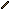 Stick (item): 8251 -> **8689**
-  Coal (item): 8252 -> **8690**
-  Raw Iron (item): 8253 -> **8691**
-  Iron Bar (item): 8254 -> **8692**
-  Iron Fragment (item): 8255 -> **8693**
-  Raw Gold (item): 8256 -> **8694**
-  Gold Bar (item): 8257 -> **8695**
-  Gold Fragment (item): 8258 -> **8696**
-  Diamond (item): 8259 -> **8697**
-  Diamond Fragment (item): 8260 -> **8698**
-  Moonstone (item): 8261 -> **8699**
-  Lunite (item): 8262 -> **8700**
-  Moonstone Fragment (item): 8263 -> **8701**
- 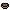 Bowl (item): 8264 -> **8702**
-  Partially Full Bowl of Cranberries (item): 8265 -> **8703**
-  Half Full Bowl of Cranberries (item): 8266 -> **8704**
-  Nearly Full Bowl of Cranberries (item): 8267 -> **8705**
-  Bowl of Cranberries (item): 8268 -> **8706**
-  Mushroom Soup (item): 8269 -> **8707**
-  Glowing Soup (item): 8270 -> **8708**
-  Night Vision Soup (item): 8271 -> **8709**
-  Cotton (item): 8272 -> **8710**
-  Gold Crop (item): 8273 -> **8711**
-  Bucket (item): 8274 -> **8712**
-  Water Bucket (item): 8275 -> **8713**
-  Lava Bucket (item): 8276 -> **8714**
- 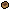 Boat (item): 8277 -> **8715**
-  INTERNAL_MESH_Boat (item): 8278 -> **8716**
-  Obsidian Boat (item): 8279 -> **8717**
-  INTERNAL_MESH_Obsidian Boat (item): 8280 -> **8718**
-  Speedboat (item): 8281 -> **8719**
-  INTERNAL_MESH_Speedboat (item): 8282 -> **8720**
-  Wood Hang Glider (item): 8283 -> **8721**
-  INTERNAL_MESH_Wood Hang Glider (item): 8284 -> **8722**
-  Iron Hang Glider (item): 8285 -> **8723**
-  INTERNAL_MESH_Iron Hang Glider (item): 8286 -> **8724**
-  Gold Hang Glider (item): 8287 -> **8725**
-  INTERNAL_MESH_Gold Hang Glider (item): 8288 -> **8726**
-  Diamond Hang Glider (item): 8289 -> **8727**
-  INTERNAL_MESH_Diamond Hang Glider (item): 8290 -> **8728**
-  Hovercraft (item): 8291 -> **8729**
-  INTERNAL_MESH_Hovercraft (item): 8292 -> **8730**
-  Yellow Kart (item): 8293 -> **8731**
-  White Kart (item): 8294 -> **8732**
-  Red Kart (item): 8295 -> **8733**
-  Purple Kart (item): 8296 -> **8734**
-  Pink Kart (item): 8297 -> **8735**
-  Orange Kart (item): 8298 -> **8736**
-  Magenta Kart (item): 8299 -> **8737**
-  Lime Kart (item): 8300 -> **8738**
-  Light Gray Kart (item): 8301 -> **8739**
-  Light Blue Kart (item): 8302 -> **8740**
-  Green Kart (item): 8303 -> **8741**
-  Gray Kart (item): 8304 -> **8742**
-  Cyan Kart (item): 8305 -> **8743**
-  Brown Kart (item): 8306 -> **8744**
-  Blue Kart (item): 8307 -> **8745**
-  Black Kart (item): 8308 -> **8746**
-  INTERNAL_MESH_Yellow Kart (item): 8309 -> **8747**
-  INTERNAL_MESH_White Kart (item): 8310 -> **8748**
-  INTERNAL_MESH_Red Kart (item): 8311 -> **8749**
-  INTERNAL_MESH_Purple Kart (item): 8312 -> **8750**
-  INTERNAL_MESH_Pink Kart (item): 8313 -> **8751**
-  INTERNAL_MESH_Orange Kart (item): 8314 -> **8752**
-  INTERNAL_MESH_Magenta Kart (item): 8315 -> **8753**
-  INTERNAL_MESH_Lime Kart (item): 8316 -> **8754**
-  INTERNAL_MESH_Light Gray Kart (item): 8317 -> **8755**
-  INTERNAL_MESH_Light Blue Kart (item): 8318 -> **8756**
-  INTERNAL_MESH_Green Kart (item): 8319 -> **8757**
-  INTERNAL_MESH_Gray Kart (item): 8320 -> **8758**
-  INTERNAL_MESH_Cyan Kart (item): 8321 -> **8759**
-  INTERNAL_MESH_Brown Kart (item): 8322 -> **8760**
-  INTERNAL_MESH_Blue Kart (item): 8323 -> **8761**
-  INTERNAL_MESH_Black Kart (item): 8324 -> **8762**
-  Off Roader (item): 8325 -> **8763**
-  INTERNAL_MESH_Off Roader (item): 8326 -> **8764**
-  Gold Mining Drill (item): 8327 -> **8765**
-  Iron Mining Drill (item): 8328 -> **8766**
-  Diamond Mining Drill (item): 8329 -> **8767**
-  Moonstone Mining Drill (item): 8330 -> **8768**
-  Armored Car (item): 8331 -> **8769**
-  INTERNAL_MESH_Gold Mining Drill (item): 8332 -> **8770**
-  INTERNAL_MESH_Iron Mining Drill (item): 8333 -> **8771**
-  INTERNAL_MESH_Diamond Mining Drill (item): 8334 -> **8772**
-  INTERNAL_MESH_Moonstone Mining Drill (item): 8335 -> **8773**
-  INTERNAL_MESH_Armored Car (item): 8336 -> **8774**
-  Light Blue Car (item): 8337 -> **8775**
-  INTERNAL_MESH_Car (item): 8338 -> **8776**
-  Snowball (item): 8339 -> **8777**
-  Snowball Launcher (item): 8340 -> **8778**
-  Pebble (item): 8341 -> **8779**
-  Reinforced Pebble (item): 8342 -> **8780**
- 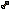 Bullet (item): 8343 -> **8781**
- 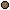 Ball (item): 8344 -> **8782**
-  Reinforced Ball (item): 8345 -> **8783**
-  Frag Grenade (item): 8346 -> **8784**
-  Mining Grenade (item): 8347 -> **8785**
-  Smoke Grenade (item): 8348 -> **8786**
-  Moonstone Orb (item): 8349 -> **8787**
-  Fireball (item): 8350 -> **8788**
-  Bouncy Bomb (item): 8351 -> **8789**
- 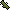 RPG (item): 8352 -> **8790**
-  Obby RPG (item): 8353 -> **8791**
-  Super RPG (item): 8354 -> **8792**
-  Grenade Launcher (item): 8355 -> **8793**
-  Iceball (item): 8356 -> **8794**
-  67 Base Projectile (item): 8357 -> **8795**
-  67 Boosted Projectile (item): 8358 -> **8796**
-  Capitano Grenade (item): 8359 -> **8797**
-  Scatter Pellet (item): 8360 -> **8798**
-  Wood Bow (item): 8361 -> **8799**
-  Wood Bow|meta|charging2 (item): 8362 -> **8800**
-  Wood Bow|meta|charging3 (item): 8363 -> **8801**
-  Wood Bow|meta|charging4 (item): 8364 -> **8802**
-  Stone Bow (item): 8365 -> **8803**
-  Stone Bow|meta|charging2 (item): 8366 -> **8804**
-  Stone Bow|meta|charging3 (item): 8367 -> **8805**
-  Stone Bow|meta|charging4 (item): 8368 -> **8806**
-  Iron Bow (item): 8369 -> **8807**
-  Iron Bow|meta|charging2 (item): 8370 -> **8808**
-  Iron Bow|meta|charging3 (item): 8371 -> **8809**
-  Iron Bow|meta|charging4 (item): 8372 -> **8810**
-  Gold Bow (item): 8373 -> **8811**
-  Gold Bow|meta|charging2 (item): 8374 -> **8812**
-  Gold Bow|meta|charging3 (item): 8375 -> **8813**
-  Gold Bow|meta|charging4 (item): 8376 -> **8814**
-  Diamond Bow (item): 8377 -> **8815**
-  Diamond Bow|meta|charging2 (item): 8378 -> **8816**
-  Diamond Bow|meta|charging3 (item): 8379 -> **8817**
-  Diamond Bow|meta|charging4 (item): 8380 -> **8818**
-  Wood Crossbow (item): 8381 -> **8819**
-  Wood Crossbow|meta|charging2 (item): 8382 -> **8820**
-  Wood Crossbow|meta|charging3 (item): 8383 -> **8821**
-  Wood Crossbow|meta|charging4 (item): 8384 -> **8822**
-  Stone Crossbow (item): 8385 -> **8823**
-  Stone Crossbow|meta|charging2 (item): 8386 -> **8824**
-  Stone Crossbow|meta|charging3 (item): 8387 -> **8825**
-  Stone Crossbow|meta|charging4 (item): 8388 -> **8826**
-  Iron Crossbow (item): 8389 -> **8827**
-  Iron Crossbow|meta|charging2 (item): 8390 -> **8828**
-  Iron Crossbow|meta|charging3 (item): 8391 -> **8829**
-  Iron Crossbow|meta|charging4 (item): 8392 -> **8830**
-  Gold Crossbow (item): 8393 -> **8831**
-  Gold Crossbow|meta|charging2 (item): 8394 -> **8832**
-  Gold Crossbow|meta|charging3 (item): 8395 -> **8833**
-  Gold Crossbow|meta|charging4 (item): 8396 -> **8834**
-  Diamond Crossbow (item): 8397 -> **8835**
-  Diamond Crossbow|meta|charging2 (item): 8398 -> **8836**
-  Diamond Crossbow|meta|charging3 (item): 8399 -> **8837**
-  Diamond Crossbow|meta|charging4 (item): 8400 -> **8838**
-  Wood Crossbow Charged (item): 8401 -> **8839**
-  Stone Crossbow Charged (item): 8402 -> **8840**
-  Iron Crossbow Charged (item): 8403 -> **8841**
-  Gold Crossbow Charged (item): 8404 -> **8842**
-  Diamond Crossbow Charged (item): 8405 -> **8843**
-  Arrow (item): 8406 -> **8844**
-  Compass (item): 8407 -> **8845**
-  Compass|meta|dir2 (item): 8408 -> **8846**
-  Compass|meta|dir3 (item): 8409 -> **8847**
-  Compass|meta|dir4 (item): 8410 -> **8848**
-  Compass|meta|dir5 (item): 8411 -> **8849**
-  Compass|meta|dir6 (item): 8412 -> **8850**
-  Compass|meta|dir7 (item): 8413 -> **8851**
-  Compass|meta|dir8 (item): 8414 -> **8852**
-  Compass|meta|dir9 (item): 8415 -> **8853**
-  Compass|meta|dir10 (item): 8416 -> **8854**
-  Compass|meta|dir11 (item): 8417 -> **8855**
-  Compass|meta|dir12 (item): 8418 -> **8856**
-  Chunk Map (item): 8419 -> **8857**
- 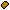 Bread (item): 8420 -> **8858**
-  Bowl of Rice (item): 8421 -> **8859**
-  Apple (item): 8422 -> **8860**
-  Plum (item): 8423 -> **8861**
- 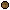 Coconut (item): 8424 -> **8862**
-  Cracked Coconut (item): 8425 -> **8863**
-  Pear (item): 8426 -> **8864**
-  Cherry (item): 8427 -> **8865**
-  Banana (item): 8428 -> **8866**
-  Watermelon Slice (item): 8429 -> **8867**
-  Gold Watermelon Slice (item): 8430 -> **8868**
-  Melon Slice (item): 8431 -> **8869**
-  Gold Melon Slice (item): 8432 -> **8870**
-  Pumpkin Pie (item): 8433 -> **8871**
-  Corn (item): 8434 -> **8872**
- 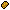 Cornbread (item): 8435 -> **8873**
-  Chili Pepper (item): 8436 -> **8874**
-  Mango (item): 8437 -> **8875**
-  Carrot (item): 8438 -> **8876**
-  Gold Carrot (item): 8439 -> **8877**
-  Raw Potato (item): 8440 -> **8878**
-  Baked Potato (item): 8441 -> **8879**
-  Beetroot (item): 8442 -> **8880**
-  Raw Porkchop (item): 8443 -> **8881**
-  Cooked Porkchop (item): 8444 -> **8882**
-  Raw Beef (item): 8445 -> **8883**
-  Steak (item): 8446 -> **8884**
-  Raw Mutton (item): 8447 -> **8885**
-  Cooked Mutton (item): 8448 -> **8886**
-  Raw Venison (item): 8449 -> **8887**
-  Cooked Venison (item): 8450 -> **8888**
-  Rotten Flesh (item): 8451 -> **8889**
-  Rotten Brain (item): 8452 -> **8890**
-  Bone (item): 8453 -> **8891**
-  Bone Meal (item): 8454 -> **8892**
-  Leather (item): 8455 -> **8893**
- 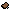 Saddle (item): 8456 -> **8894**
-  Spirit Saddle (item): 8457 -> **8895**
-  Fur (item): 8458 -> **8896**
-  Golem Eye (item): 8459 -> **8897**
-  Knight Heart (item): 8460 -> **8898**
-  Teleport Heart (item): 8461 -> **8899**
-  Frost Shard (item): 8462 -> **8900**
-  Molten Cog (item): 8463 -> **8901**
-  Choir Bell (item): 8464 -> **8902**
-  Siege Core (item): 8465 -> **8903**
-  Flywheel (item): 8466 -> **8904**
-  Radiant Spark (item): 8467 -> **8905**
-  Brood Sac (item): 8468 -> **8906**
- 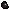 Bandolier (item): 8469 -> **8907**
-  Name Tag (item): 8470 -> **8908**
- 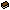 Book (item): 8471 -> **8909**
-  Empty Bottle (item): 8472 -> **8910**
-  Water Bottle (item): 8473 -> **8911**
-  Slowness Potion (item): 8474 -> **8912**
-  Slowness Potion II (item): 8475 -> **8913**
-  Splash Slowness Potion (item): 8476 -> **8914**
-  Splash Slowness Potion II (item): 8477 -> **8915**
-  Arrow of Slowness (item): 8478 -> **8916**
-  Poison Potion (item): 8479 -> **8917**
-  Poison Potion II (item): 8480 -> **8918**
-  Splash Poison Potion (item): 8481 -> **8919**
-  Splash Poison Potion II (item): 8482 -> **8920**
-  Arrow of Poison (item): 8483 -> **8921**
-  Weakness Potion (item): 8484 -> **8922**
-  Weakness Potion II (item): 8485 -> **8923**
-  Splash Weakness Potion (item): 8486 -> **8924**
-  Splash Weakness Potion II (item): 8487 -> **8925**
-  Arrow of Weakness (item): 8488 -> **8926**
-  Instant Damage Potion (item): 8489 -> **8927**
-  Instant Damage Potion II (item): 8490 -> **8928**
-  Splash Instant Damage Potion (item): 8491 -> **8929**
-  Splash Instant Damage Potion II (item): 8492 -> **8930**
-  Arrow of Instant Damage (item): 8493 -> **8931**
-  Milk Potion (item): 8494 -> **8932**
-  Splash Milk Potion (item): 8495 -> **8933**
-  Arrow of Milk (item): 8496 -> **8934**
-  Speed Potion (item): 8497 -> **8935**
-  Speed Potion II (item): 8498 -> **8936**
-  Splash Speed Potion (item): 8499 -> **8937**
-  Splash Speed Potion II (item): 8500 -> **8938**
-  Arrow of Speed (item): 8501 -> **8939**
-  Defense Potion (item): 8502 -> **8940**
-  Defense Potion II (item): 8503 -> **8941**
-  Splash Defense Potion (item): 8504 -> **8942**
-  Splash Defense Potion II (item): 8505 -> **8943**
-  Arrow of Defense (item): 8506 -> **8944**
-  Strength Potion (item): 8507 -> **8945**
-  Strength Potion II (item): 8508 -> **8946**
-  Splash Strength Potion (item): 8509 -> **8947**
-  Splash Strength Potion II (item): 8510 -> **8948**
-  Arrow of Strength (item): 8511 -> **8949**
-  Invisibility Potion (item): 8512 -> **8950**
-  Splash Invisibility Potion (item): 8513 -> **8951**
-  Arrow of Invisibility (item): 8514 -> **8952**
-  Jump Potion (item): 8515 -> **8953**
-  Jump Potion II (item): 8516 -> **8954**
-  Splash Jump Potion (item): 8517 -> **8955**
-  Splash Jump Potion II (item): 8518 -> **8956**
-  Arrow of Jumping (item): 8519 -> **8957**
-  Knockback Potion (item): 8520 -> **8958**
-  Splash Knockback Potion (item): 8521 -> **8959**
-  Splash Knockback Potion II (item): 8522 -> **8960**
-  Arrow of Knockback (item): 8523 -> **8961**
-  Regeneration Potion (item): 8524 -> **8962**
-  Regeneration Potion II (item): 8525 -> **8963**
-  Splash Regeneration Potion (item): 8526 -> **8964**
-  Splash Regeneration Potion II (item): 8527 -> **8965**
-  Arrow of Regeneration (item): 8528 -> **8966**
-  Instant Healing Potion (item): 8529 -> **8967**
-  Instant Healing Potion II (item): 8530 -> **8968**
-  Splash Instant Healing Potion (item): 8531 -> **8969**
-  Splash Instant Healing Potion II (item): 8532 -> **8970**
-  Arrow of Instant Healing (item): 8533 -> **8971**
-  Haste Potion (item): 8534 -> **8972**
-  Haste Potion II (item): 8535 -> **8973**
-  Splash Haste Potion (item): 8536 -> **8974**
-  Splash Haste Potion II (item): 8537 -> **8975**
-  Arrow of Haste (item): 8538 -> **8976**
-  Shield Potion (item): 8539 -> **8977**
-  Shield Potion II (item): 8540 -> **8978**
-  Splash Shield Potion (item): 8541 -> **8979**
-  Splash Shield Potion II (item): 8542 -> **8980**
-  Arrow of Shield (item): 8543 -> **8981**
-  Double Jump Potion (item): 8544 -> **8982**
-  Splash Double Jump Potion (item): 8545 -> **8983**
-  Arrow of Double Jump (item): 8546 -> **8984**
-  Heat Resistance Potion (item): 8547 -> **8985**
-  Splash Heat Resistance Potion (item): 8548 -> **8986**
-  Arrow of Heat Resistance (item): 8549 -> **8987**
-  X-Ray Vision Potion (item): 8550 -> **8988**
-  Splash X-Ray Vision Potion (item): 8551 -> **8989**
-  Arrow of X-Ray Vision (item): 8552 -> **8990**
-  Mining Yield Potion (item): 8553 -> **8991**
-  Mining Yield Potion II (item): 8554 -> **8992**
-  Splash Mining Yield Potion (item): 8555 -> **8993**
-  Splash Mining Yield Potion II (item): 8556 -> **8994**
-  Arrow of Mining Yield (item): 8557 -> **8995**
-  Brain Rot Potion (item): 8558 -> **8996**
-  Splash Brain Rot Potion (item): 8559 -> **8997**
-  Arrow of Brain Rot (item): 8560 -> **8998**
-  Chaos Potion (item): 8561 -> **8999**
-  Teleportation Potion (item): 8562 -> **9000**
-  Ammo (item): 8563 -> **9001**
- 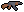 AK-47 (item): 8564 -> **9002**
-  AK-47|RequiresAmmo (item): 8565 -> **9003**
-  M16 (item): 8566 -> **9004**
-  M16|RequiresAmmo (item): 8567 -> **9005**
-  MP40 (item): 8568 -> **9006**
-  MP40|RequiresAmmo (item): 8569 -> **9007**
-  TAR-21 (item): 8570 -> **9008**
-  TAR-21|RequiresAmmo (item): 8571 -> **9009**
-  M1911 (item): 8572 -> **9010**
-  M1911|RequiresAmmo (item): 8573 -> **9011**
-  One Shot Pistol (item): 8574 -> **9012**
-  One Shot Pistol|RequiresAmmo (item): 8575 -> **9013**
-  Double Barrel (item): 8576 -> **9014**
-  Double Barrel|RequiresAmmo (item): 8577 -> **9015**
-  AWP (item): 8578 -> **9016**
-  AWP|RequiresAmmo (item): 8579 -> **9017**
-  Deagle (item): 8580 -> **9018**
-  Deagle|RequiresAmmo (item): 8581 -> **9019**
-  Striker-12 (item): 8582 -> **9020**
-  Striker-12|RequiresAmmo (item): 8583 -> **9021**
-  VSR (item): 8584 -> **9022**
-  VSR|RequiresAmmo (item): 8585 -> **9023**
-  DMR (item): 8586 -> **9024**
-  DMR|RequiresAmmo (item): 8587 -> **9025**
-  Minigun (item): 8588 -> **9026**
-  Minigun|RequiresAmmo (item): 8589 -> **9027**
-  FMR (item): 8590 -> **9028**
-  FMR|RequiresAmmo (item): 8591 -> **9029**
-  SKAR (item): 8592 -> **9030**
-  SKAR|RequiresAmmo (item): 8593 -> **9031**
-  Block-19 (item): 8594 -> **9032**
-  Block-19|RequiresAmmo (item): 8595 -> **9033**
-  Mini Izu (item): 8596 -> **9034**
-  Mini Izu|RequiresAmmo (item): 8597 -> **9035**
-  GPMG (item): 8598 -> **9036**
-  GPMG|RequiresAmmo (item): 8599 -> **9037**
-  Gold Coin (item): 8600 -> **9038**
-  Updraft (item): 8601 -> **9039**
-  Snowdash (item): 8602 -> **9040**
-  Floor Creator (item): 8603 -> **9041**
-  Moonstone Remote Explosive (item): 8604 -> **9042**
-  Moonstone Remote (item): 8605 -> **9043**
-  Ice Bridge (item): 8606 -> **9044**
-  Maple Planks Bridge (item): 8607 -> **9045**
-  Messy Stone Bridge (item): 8608 -> **9046**
-  Yellow Balloon (item): 8609 -> **9047**
-  White Balloon (item): 8610 -> **9048**
-  Red Balloon (item): 8611 -> **9049**
-  Purple Balloon (item): 8612 -> **9050**
-  Pink Balloon (item): 8613 -> **9051**
-  Orange Balloon (item): 8614 -> **9052**
-  Magenta Balloon (item): 8615 -> **9053**
-  Lime Balloon (item): 8616 -> **9054**
-  Light Gray Balloon (item): 8617 -> **9055**
-  Light Blue Balloon (item): 8618 -> **9056**
-  Green Balloon (item): 8619 -> **9057**
-  Gray Balloon (item): 8620 -> **9058**
-  Cyan Balloon (item): 8621 -> **9059**
-  Brown Balloon (item): 8622 -> **9060**
-  Blue Balloon (item): 8623 -> **9061**
-  Black Balloon (item): 8624 -> **9062**
-  INTERNAL_MESH_Yellow Balloon (item): 8625 -> **9063**
-  INTERNAL_MESH_White Balloon (item): 8626 -> **9064**
-  INTERNAL_MESH_Red Balloon (item): 8627 -> **9065**
-  INTERNAL_MESH_Purple Balloon (item): 8628 -> **9066**
-  INTERNAL_MESH_Pink Balloon (item): 8629 -> **9067**
-  INTERNAL_MESH_Orange Balloon (item): 8630 -> **9068**
-  INTERNAL_MESH_Magenta Balloon (item): 8631 -> **9069**
-  INTERNAL_MESH_Lime Balloon (item): 8632 -> **9070**
-  INTERNAL_MESH_Light Gray Balloon (item): 8633 -> **9071**
-  INTERNAL_MESH_Light Blue Balloon (item): 8634 -> **9072**
-  INTERNAL_MESH_Green Balloon (item): 8635 -> **9073**
-  INTERNAL_MESH_Gray Balloon (item): 8636 -> **9074**
-  INTERNAL_MESH_Cyan Balloon (item): 8637 -> **9075**
-  INTERNAL_MESH_Brown Balloon (item): 8638 -> **9076**
-  INTERNAL_MESH_Blue Balloon (item): 8639 -> **9077**
-  INTERNAL_MESH_Black Balloon (item): 8640 -> **9078**
-  Yellow Popup Tower (item): 8641 -> **9079**
-  White Popup Tower (item): 8642 -> **9080**
-  Red Popup Tower (item): 8643 -> **9081**
-  Purple Popup Tower (item): 8644 -> **9082**
-  Pink Popup Tower (item): 8645 -> **9083**
-  Orange Popup Tower (item): 8646 -> **9084**
-  Magenta Popup Tower (item): 8647 -> **9085**
-  Lime Popup Tower (item): 8648 -> **9086**
-  Light Gray Popup Tower (item): 8649 -> **9087**
-  Light Blue Popup Tower (item): 8650 -> **9088**
-  Green Popup Tower (item): 8651 -> **9089**
-  Gray Popup Tower (item): 8652 -> **9090**
-  Cyan Popup Tower (item): 8653 -> **9091**
-  Brown Popup Tower (item): 8654 -> **9092**
-  Blue Popup Tower (item): 8655 -> **9093**
-  Black Popup Tower (item): 8656 -> **9094**
-  Yellow Paintball Gun (item): 8657 -> **9095**
-  White Paintball Gun (item): 8658 -> **9096**
-  Red Paintball Gun (item): 8659 -> **9097**
-  Purple Paintball Gun (item): 8660 -> **9098**
-  Pink Paintball Gun (item): 8661 -> **9099**
-  Orange Paintball Gun (item): 8662 -> **9100**
-  Magenta Paintball Gun (item): 8663 -> **9101**
-  Lime Paintball Gun (item): 8664 -> **9102**
-  Light Gray Paintball Gun (item): 8665 -> **9103**
-  Light Blue Paintball Gun (item): 8666 -> **9104**
-  Green Paintball Gun (item): 8667 -> **9105**
-  Gray Paintball Gun (item): 8668 -> **9106**
-  Cyan Paintball Gun (item): 8669 -> **9107**
-  Brown Paintball Gun (item): 8670 -> **9108**
-  Blue Paintball Gun (item): 8671 -> **9109**
-  Black Paintball Gun (item): 8672 -> **9110**
-  Yellow Paintball (item): 8673 -> **9111**
-  White Paintball (item): 8674 -> **9112**
-  Red Paintball (item): 8675 -> **9113**
-  Purple Paintball (item): 8676 -> **9114**
-  Pink Paintball (item): 8677 -> **9115**
-  Orange Paintball (item): 8678 -> **9116**
-  Magenta Paintball (item): 8679 -> **9117**
-  Lime Paintball (item): 8680 -> **9118**
-  Light Gray Paintball (item): 8681 -> **9119**
-  Light Blue Paintball (item): 8682 -> **9120**
-  Green Paintball (item): 8683 -> **9121**
-  Gray Paintball (item): 8684 -> **9122**
-  Cyan Paintball (item): 8685 -> **9123**
-  Brown Paintball (item): 8686 -> **9124**
-  Blue Paintball (item): 8687 -> **9125**
-  Black Paintball (item): 8688 -> **9126**
-  Yellow Heavy Paintball Gun (item): 8689 -> **9127**
-  White Heavy Paintball Gun (item): 8690 -> **9128**
-  Red Heavy Paintball Gun (item): 8691 -> **9129**
-  Purple Heavy Paintball Gun (item): 8692 -> **9130**
-  Pink Heavy Paintball Gun (item): 8693 -> **9131**
-  Orange Heavy Paintball Gun (item): 8694 -> **9132**
-  Magenta Heavy Paintball Gun (item): 8695 -> **9133**
-  Lime Heavy Paintball Gun (item): 8696 -> **9134**
-  Light Gray Heavy Paintball Gun (item): 8697 -> **9135**
-  Light Blue Heavy Paintball Gun (item): 8698 -> **9136**
-  Green Heavy Paintball Gun (item): 8699 -> **9137**
-  Gray Heavy Paintball Gun (item): 8700 -> **9138**
-  Cyan Heavy Paintball Gun (item): 8701 -> **9139**
-  Brown Heavy Paintball Gun (item): 8702 -> **9140**
-  Blue Heavy Paintball Gun (item): 8703 -> **9141**
-  Black Heavy Paintball Gun (item): 8704 -> **9142**
-  Yellow Paintball Explosive Item (item): 8705 -> **9143**
-  White Paintball Explosive Item (item): 8706 -> **9144**
-  Red Paintball Explosive Item (item): 8707 -> **9145**
-  Purple Paintball Explosive Item (item): 8708 -> **9146**
-  Pink Paintball Explosive Item (item): 8709 -> **9147**
-  Orange Paintball Explosive Item (item): 8710 -> **9148**
-  Magenta Paintball Explosive Item (item): 8711 -> **9149**
-  Lime Paintball Explosive Item (item): 8712 -> **9150**
-  Light Gray Paintball Explosive Item (item): 8713 -> **9151**
-  Light Blue Paintball Explosive Item (item): 8714 -> **9152**
-  Green Paintball Explosive Item (item): 8715 -> **9153**
-  Gray Paintball Explosive Item (item): 8716 -> **9154**
-  Cyan Paintball Explosive Item (item): 8717 -> **9155**
-  Brown Paintball Explosive Item (item): 8718 -> **9156**
-  Blue Paintball Explosive Item (item): 8719 -> **9157**
-  Black Paintball Explosive Item (item): 8720 -> **9158**
-  Yellow Sticky Paintball Explosive Item (item): 8721 -> **9159**
-  White Sticky Paintball Explosive Item (item): 8722 -> **9160**
-  Red Sticky Paintball Explosive Item (item): 8723 -> **9161**
-  Purple Sticky Paintball Explosive Item (item): 8724 -> **9162**
-  Pink Sticky Paintball Explosive Item (item): 8725 -> **9163**
-  Orange Sticky Paintball Explosive Item (item): 8726 -> **9164**
-  Magenta Sticky Paintball Explosive Item (item): 8727 -> **9165**
-  Lime Sticky Paintball Explosive Item (item): 8728 -> **9166**
-  Light Gray Sticky Paintball Explosive Item (item): 8729 -> **9167**
-  Light Blue Sticky Paintball Explosive Item (item): 8730 -> **9168**
-  Green Sticky Paintball Explosive Item (item): 8731 -> **9169**
-  Gray Sticky Paintball Explosive Item (item): 8732 -> **9170**
-  Cyan Sticky Paintball Explosive Item (item): 8733 -> **9171**
-  Brown Sticky Paintball Explosive Item (item): 8734 -> **9172**
-  Blue Sticky Paintball Explosive Item (item): 8735 -> **9173**
-  Black Sticky Paintball Explosive Item (item): 8736 -> **9174**
-  Yellow Seeking Paintball Explosive Item (item): 8737 -> **9175**
-  White Seeking Paintball Explosive Item (item): 8738 -> **9176**
-  Red Seeking Paintball Explosive Item (item): 8739 -> **9177**
-  Purple Seeking Paintball Explosive Item (item): 8740 -> **9178**
-  Pink Seeking Paintball Explosive Item (item): 8741 -> **9179**
-  Orange Seeking Paintball Explosive Item (item): 8742 -> **9180**
-  Magenta Seeking Paintball Explosive Item (item): 8743 -> **9181**
-  Lime Seeking Paintball Explosive Item (item): 8744 -> **9182**
-  Light Gray Seeking Paintball Explosive Item (item): 8745 -> **9183**
-  Light Blue Seeking Paintball Explosive Item (item): 8746 -> **9184**
-  Green Seeking Paintball Explosive Item (item): 8747 -> **9185**
-  Gray Seeking Paintball Explosive Item (item): 8748 -> **9186**
-  Cyan Seeking Paintball Explosive Item (item): 8749 -> **9187**
-  Brown Seeking Paintball Explosive Item (item): 8750 -> **9188**
-  Blue Seeking Paintball Explosive Item (item): 8751 -> **9189**
-  Black Seeking Paintball Explosive Item (item): 8752 -> **9190**
-  Yellow Quick Paintball Explosive Item (item): 8753 -> **9191**
-  White Quick Paintball Explosive Item (item): 8754 -> **9192**
-  Red Quick Paintball Explosive Item (item): 8755 -> **9193**
-  Purple Quick Paintball Explosive Item (item): 8756 -> **9194**
-  Pink Quick Paintball Explosive Item (item): 8757 -> **9195**
-  Orange Quick Paintball Explosive Item (item): 8758 -> **9196**
-  Magenta Quick Paintball Explosive Item (item): 8759 -> **9197**
-  Lime Quick Paintball Explosive Item (item): 8760 -> **9198**
-  Light Gray Quick Paintball Explosive Item (item): 8761 -> **9199**
-  Light Blue Quick Paintball Explosive Item (item): 8762 -> **9200**
-  Green Quick Paintball Explosive Item (item): 8763 -> **9201**
-  Gray Quick Paintball Explosive Item (item): 8764 -> **9202**
-  Cyan Quick Paintball Explosive Item (item): 8765 -> **9203**
-  Brown Quick Paintball Explosive Item (item): 8766 -> **9204**
-  Blue Quick Paintball Explosive Item (item): 8767 -> **9205**
-  Black Quick Paintball Explosive Item (item): 8768 -> **9206**
-  Yellow Paint Bow (item): 8769 -> **9207**
-  Yellow Paint Bow|meta|charging2 (item): 8770 -> **9208**
-  Yellow Paint Bow|meta|charging3 (item): 8771 -> **9209**
-  Yellow Paint Bow|meta|charging4 (item): 8772 -> **9210**
-  White Paint Bow (item): 8773 -> **9211**
-  White Paint Bow|meta|charging2 (item): 8774 -> **9212**
-  White Paint Bow|meta|charging3 (item): 8775 -> **9213**
-  White Paint Bow|meta|charging4 (item): 8776 -> **9214**
-  Red Paint Bow (item): 8777 -> **9215**
-  Red Paint Bow|meta|charging2 (item): 8778 -> **9216**
-  Red Paint Bow|meta|charging3 (item): 8779 -> **9217**
-  Red Paint Bow|meta|charging4 (item): 8780 -> **9218**
-  Purple Paint Bow (item): 8781 -> **9219**
-  Purple Paint Bow|meta|charging2 (item): 8782 -> **9220**
-  Purple Paint Bow|meta|charging3 (item): 8783 -> **9221**
-  Purple Paint Bow|meta|charging4 (item): 8784 -> **9222**
-  Pink Paint Bow (item): 8785 -> **9223**
-  Pink Paint Bow|meta|charging2 (item): 8786 -> **9224**
-  Pink Paint Bow|meta|charging3 (item): 8787 -> **9225**
-  Pink Paint Bow|meta|charging4 (item): 8788 -> **9226**
-  Orange Paint Bow (item): 8789 -> **9227**
-  Orange Paint Bow|meta|charging2 (item): 8790 -> **9228**
-  Orange Paint Bow|meta|charging3 (item): 8791 -> **9229**
-  Orange Paint Bow|meta|charging4 (item): 8792 -> **9230**
-  Magenta Paint Bow (item): 8793 -> **9231**
-  Magenta Paint Bow|meta|charging2 (item): 8794 -> **9232**
-  Magenta Paint Bow|meta|charging3 (item): 8795 -> **9233**
-  Magenta Paint Bow|meta|charging4 (item): 8796 -> **9234**
-  Lime Paint Bow (item): 8797 -> **9235**
-  Lime Paint Bow|meta|charging2 (item): 8798 -> **9236**
-  Lime Paint Bow|meta|charging3 (item): 8799 -> **9237**
-  Lime Paint Bow|meta|charging4 (item): 8800 -> **9238**
-  Light Gray Paint Bow (item): 8801 -> **9239**
-  Light Gray Paint Bow|meta|charging2 (item): 8802 -> **9240**
-  Light Gray Paint Bow|meta|charging3 (item): 8803 -> **9241**
-  Light Gray Paint Bow|meta|charging4 (item): 8804 -> **9242**
-  Light Blue Paint Bow (item): 8805 -> **9243**
-  Light Blue Paint Bow|meta|charging2 (item): 8806 -> **9244**
-  Light Blue Paint Bow|meta|charging3 (item): 8807 -> **9245**
-  Light Blue Paint Bow|meta|charging4 (item): 8808 -> **9246**
-  Green Paint Bow (item): 8809 -> **9247**
-  Green Paint Bow|meta|charging2 (item): 8810 -> **9248**
-  Green Paint Bow|meta|charging3 (item): 8811 -> **9249**
-  Green Paint Bow|meta|charging4 (item): 8812 -> **9250**
-  Gray Paint Bow (item): 8813 -> **9251**
-  Gray Paint Bow|meta|charging2 (item): 8814 -> **9252**
-  Gray Paint Bow|meta|charging3 (item): 8815 -> **9253**
-  Gray Paint Bow|meta|charging4 (item): 8816 -> **9254**
-  Cyan Paint Bow (item): 8817 -> **9255**
-  Cyan Paint Bow|meta|charging2 (item): 8818 -> **9256**
-  Cyan Paint Bow|meta|charging3 (item): 8819 -> **9257**
-  Cyan Paint Bow|meta|charging4 (item): 8820 -> **9258**
-  Brown Paint Bow (item): 8821 -> **9259**
-  Brown Paint Bow|meta|charging2 (item): 8822 -> **9260**
-  Brown Paint Bow|meta|charging3 (item): 8823 -> **9261**
-  Brown Paint Bow|meta|charging4 (item): 8824 -> **9262**
-  Blue Paint Bow (item): 8825 -> **9263**
-  Blue Paint Bow|meta|charging2 (item): 8826 -> **9264**
-  Blue Paint Bow|meta|charging3 (item): 8827 -> **9265**
-  Blue Paint Bow|meta|charging4 (item): 8828 -> **9266**
-  Black Paint Bow (item): 8829 -> **9267**
-  Black Paint Bow|meta|charging2 (item): 8830 -> **9268**
-  Black Paint Bow|meta|charging3 (item): 8831 -> **9269**
-  Black Paint Bow|meta|charging4 (item): 8832 -> **9270**
-  Pig Spawn Orb (item): 8833 -> **9271**
-  Cow Spawn Orb (item): 8834 -> **9272**
-  Sheep Spawn Orb (item): 8835 -> **9273**
-  Horse Spawn Orb (item): 8836 -> **9274**
-  Camel Spawn Orb (item): 8837 -> **9275**
-  Iron Goofy Golem Spawn Orb (item): 8838 -> **9276**
-  Gold Goofy Golem Spawn Orb (item): 8839 -> **9277**
-  Diamond Goofy Golem Spawn Orb (item): 8840 -> **9278**
-  Moonstone Goofy Golem Spawn Orb (item): 8841 -> **9279**
-  Deer Spawn Orb (item): 8842 -> **9280**
-  Slime Spawn Orb (item): 8843 -> **9281**
-  Wolf Spawn Orb (item): 8844 -> **9282**
-  Wildcat Spawn Orb (item): 8845 -> **9283**
-  Spirit Golem Spawn Orb (item): 8846 -> **9284**
-  Spirit Wolf Spawn Orb (item): 8847 -> **9285**
-  Spirit Bear Spawn Orb (item): 8848 -> **9286**
-  Spirit Stag Spawn Orb (item): 8849 -> **9287**
-  Spirit Gorilla Spawn Orb (item): 8850 -> **9288**
-  Bear Spawn Orb (item): 8851 -> **9289**
-  Stag Spawn Orb (item): 8852 -> **9290**
-  Gold Watermelon Stag Spawn Orb (item): 8853 -> **9291**
-  Gorilla Spawn Orb (item): 8854 -> **9292**
-  Cave Golem Spawn Orb (item): 8855 -> **9293**
-  Draugr Zombie Spawn Orb (item): 8856 -> **9294**
-  Draugr Skeleton Spawn Orb (item): 8857 -> **9295**
-  Frost Golem Spawn Orb (item): 8858 -> **9296**
-  Frost Zombie Spawn Orb (item): 8859 -> **9297**
-  Frost Skeleton Spawn Orb (item): 8860 -> **9298**
-  Draugr Knight Spawn Orb (item): 8861 -> **9299**
-  Draugr Huntress Spawn Orb (item): 8862 -> **9300**
-  Magma Golem Spawn Orb (item): 8863 -> **9301**
-  Draugr Warper Spawn Orb (item): 8864 -> **9302**
-  Frost Wraith Spawn Orb (item): 8865 -> **9303**
-  Draugr Reaver Spawn Orb (item): 8866 -> **9304**
-  Stalker Spawn Orb (item): 8867 -> **9305**
-  Crone Spawn Orb (item): 8868 -> **9306**
-  Iron Guardian Spawn Orb (item): 8869 -> **9307**
-  Gold Guardian Spawn Orb (item): 8870 -> **9308**
-  Diamond Guardian Spawn Orb (item): 8871 -> **9309**
-  Moonstone Guardian Spawn Orb (item): 8872 -> **9310**
-  Tiki Terror Spawn Orb (item): 8873 -> **9311**
-  Mob Catcher (item): 8874 -> **9312**
-  Caught Mob Pig Default (item): 8875 -> **9313**
-  Caught Mob Cow Default (item): 8876 -> **9314**
-  Caught Mob Cow Cream (item): 8877 -> **9315**
-  Caught Mob Sheep Default (item): 8878 -> **9316**
-  Caught Mob Sheep Black (item): 8879 -> **9317**
-  Caught Mob Sheep Red (item): 8880 -> **9318**
-  Caught Mob Sheep Orange (item): 8881 -> **9319**
-  Caught Mob Sheep Pink (item): 8882 -> **9320**
-  Caught Mob Sheep Purple (item): 8883 -> **9321**
-  Caught Mob Sheep Yellow (item): 8884 -> **9322**
-  Caught Mob Sheep Blue (item): 8885 -> **9323**
-  Caught Mob Sheep Brown (item): 8886 -> **9324**
-  Caught Mob Sheep Cyan (item): 8887 -> **9325**
-  Caught Mob Sheep Gray (item): 8888 -> **9326**
-  Caught Mob Sheep Green (item): 8889 -> **9327**
-  Caught Mob Sheep Lightblue (item): 8890 -> **9328**
-  Caught Mob Sheep Lightgray (item): 8891 -> **9329**
-  Caught Mob Sheep Lime (item): 8892 -> **9330**
-  Caught Mob Sheep Magenta (item): 8893 -> **9331**
-  Caught Mob Horse Default (item): 8894 -> **9332**
-  Caught Mob Horse Black (item): 8895 -> **9333**
-  Caught Mob Horse Brown (item): 8896 -> **9334**
-  Caught Mob Horse Cream (item): 8897 -> **9335**
-  Caught Mob Camel Default (item): 8898 -> **9336**
-  Caught Mob Camel Brown (item): 8899 -> **9337**
-  Caught Mob Iron_Goofy_Golem Default (item): 8900 -> **9338**
-  Caught Mob Iron_Goofy_Golem Flaking (item): 8901 -> **9339**
-  Caught Mob Iron_Goofy_Golem Patchy (item): 8902 -> **9340**
-  Caught Mob Iron_Goofy_Golem Shedding (item): 8903 -> **9341**
-  Caught Mob Iron_Goofy_Golem Bare (item): 8904 -> **9342**
-  Caught Mob Iron_Goofy_Golem Stone (item): 8905 -> **9343**
-  Caught Mob Gold_Goofy_Golem Default (item): 8906 -> **9344**
-  Caught Mob Gold_Goofy_Golem Flaking (item): 8907 -> **9345**
-  Caught Mob Gold_Goofy_Golem Patchy (item): 8908 -> **9346**
-  Caught Mob Gold_Goofy_Golem Shedding (item): 8909 -> **9347**
-  Caught Mob Gold_Goofy_Golem Bare (item): 8910 -> **9348**
-  Caught Mob Gold_Goofy_Golem Stone (item): 8911 -> **9349**
-  Caught Mob Diamond_Goofy_Golem Default (item): 8912 -> **9350**
-  Caught Mob Diamond_Goofy_Golem Flaking (item): 8913 -> **9351**
-  Caught Mob Diamond_Goofy_Golem Patchy (item): 8914 -> **9352**
-  Caught Mob Diamond_Goofy_Golem Shedding (item): 8915 -> **9353**
-  Caught Mob Diamond_Goofy_Golem Bare (item): 8916 -> **9354**
-  Caught Mob Diamond_Goofy_Golem Stone (item): 8917 -> **9355**
-  Caught Mob Moonstone_Goofy_Golem Default (item): 8918 -> **9356**
-  Caught Mob Moonstone_Goofy_Golem Flaking (item): 8919 -> **9357**
-  Caught Mob Moonstone_Goofy_Golem Patchy (item): 8920 -> **9358**
-  Caught Mob Moonstone_Goofy_Golem Shedding (item): 8921 -> **9359**
-  Caught Mob Moonstone_Goofy_Golem Bare (item): 8922 -> **9360**
-  Caught Mob Moonstone_Goofy_Golem Stone (item): 8923 -> **9361**
-  Caught Mob Deer Default (item): 8924 -> **9362**
-  Caught Mob Slime Default (item): 8925 -> **9363**
-  Caught Mob Wolf Default (item): 8926 -> **9364**
-  Caught Mob Wolf White (item): 8927 -> **9365**
-  Caught Mob Wolf Brown (item): 8928 -> **9366**
-  Caught Mob Wolf Grey (item): 8929 -> **9367**
-  Caught Mob Wolf Spectral (item): 8930 -> **9368**
-  Caught Mob Wildcat Default (item): 8931 -> **9369**
-  Caught Mob Wildcat Tabby (item): 8932 -> **9370**
-  Caught Mob Wildcat Grey (item): 8933 -> **9371**
-  Caught Mob Wildcat Black (item): 8934 -> **9372**
-  Caught Mob Wildcat Calico (item): 8935 -> **9373**
-  Caught Mob Wildcat Siamese (item): 8936 -> **9374**
-  Caught Mob Wildcat Leopard (item): 8937 -> **9375**
-  Caught Mob Spirit_Golem Default (item): 8938 -> **9376**
-  Caught Mob Spirit_Wolf Default (item): 8939 -> **9377**
-  Caught Mob Spirit_Bear Default (item): 8940 -> **9378**
-  Caught Mob Spirit_Stag Default (item): 8941 -> **9379**
-  Caught Mob Spirit_Gorilla Default (item): 8942 -> **9380**
-  Caught Mob Bear Default (item): 8943 -> **9381**
-  Caught Mob Stag Default (item): 8944 -> **9382**
-  Caught Mob Gold_Watermelon_Stag Default (item): 8945 -> **9383**
-  Caught Mob Gorilla Default (item): 8946 -> **9384**
-  Caught Mob Cave_Golem Default (item): 8947 -> **9385**
-  Caught Mob Cave_Golem Iron (item): 8948 -> **9386**
-  Caught Mob Cave_Golem Corrupted (item): 8949 -> **9387**
-  Caught Mob Draugr_Zombie Default (item): 8950 -> **9388**
-  Caught Mob Draugr_Zombie Longhairchestplate (item): 8951 -> **9389**
-  Caught Mob Draugr_Zombie Longhairclothed (item): 8952 -> **9390**
-  Caught Mob Draugr_Zombie Shorthairclothed (item): 8953 -> **9391**
-  Caught Mob Draugr_Zombie Flower (item): 8954 -> **9392**
-  Caught Mob Draugr_Zombie Flower2 (item): 8955 -> **9393**
-  Caught Mob Draugr_Zombie Mushroom (item): 8956 -> **9394**
-  Caught Mob Draugr_Zombie Vine (item): 8957 -> **9395**
-  Caught Mob Draugr_Zombie Vine2 (item): 8958 -> **9396**
-  Caught Mob Draugr_Zombie Corrupted (item): 8959 -> **9397**
-  Caught Mob Draugr_Zombie Corrupted2 (item): 8960 -> **9398**
-  Caught Mob Draugr_Skeleton Default (item): 8961 -> **9399**
-  Caught Mob Frost_Golem Default (item): 8962 -> **9400**
-  Caught Mob Frost_Zombie Default (item): 8963 -> **9401**
-  Caught Mob Frost_Zombie Longhairchestplate (item): 8964 -> **9402**
-  Caught Mob Frost_Zombie Shorthairclothed (item): 8965 -> **9403**
-  Caught Mob Frost_Skeleton Default (item): 8966 -> **9404**
-  Caught Mob Draugr_Knight Default (item): 8967 -> **9405**
-  Caught Mob Draugr_Huntress Default (item): 8968 -> **9406**
-  Caught Mob Draugr_Huntress Chainmail (item): 8969 -> **9407**
-  Caught Mob Magma_Golem Default (item): 8970 -> **9408**
-  Caught Mob Draugr_Warper Default (item): 8971 -> **9409**
-  Caught Mob Frost_Wraith Default (item): 8972 -> **9410**
-  Caught Mob Frost_Wraith Tattered (item): 8973 -> **9411**
-  Caught Mob Frost_Wraith Frostking (item): 8974 -> **9412**
-  Caught Mob Frost_Wraith Accursed (item): 8975 -> **9413**
-  Caught Mob Draugr_Reaver Default (item): 8976 -> **9414**
-  Caught Mob Stalker Default (item): 8977 -> **9415**
-  Caught Mob Stalker Crimson (item): 8978 -> **9416**
-  Caught Mob Stalker Frost (item): 8979 -> **9417**
-  Caught Mob Stalker Void (item): 8980 -> **9418**
-  Caught Mob Crone Default (item): 8981 -> **9419**
-  Caught Mob Iron_Guardian Default (item): 8982 -> **9420**
-  Caught Mob Gold_Guardian Default (item): 8983 -> **9421**
-  Caught Mob Diamond_Guardian Default (item): 8984 -> **9422**
-  Caught Mob Moonstone_Guardian Default (item): 8985 -> **9423**
-  Caught Mob Tiki_Terror Default (item): 8986 -> **9424**
-  Caught Mob Tiki_Terror Titan (item): 8987 -> **9425**
-  Caught Mob Tiki_Terror Tormentor (item): 8988 -> **9426**
-  Caught Mob Tiki_Terror Tyrant (item): 8989 -> **9427**
- Caught Mob NPC Default (item): 8990 -> **9428**
- Caught Mob NPC Emma (item): 8991 -> **9429**
- Caught Mob NPC Leo (item): 8992 -> **9430**
- Caught Mob NPC Isabel (item): 8993 -> **9431**
- Caught Mob NPC Sanjay (item): 8994 -> **9432**
- Caught Mob NPC Imara (item): 8995 -> **9433**
- Caught Mob NPC Enoch (item): 8996 -> **9434**
- Caught Mob NPC Sara (item): 8997 -> **9435**
- Caught Mob NPC Carmen (item): 8998 -> **9436**
- Caught Mob NPC Chef (item): 8999 -> **9437**
-  Caught Mob 67 Default (item): 9000 -> **9438**
-  Caught Mob Bobino_Musculino Default (item): 9001 -> **9439**
-  Caught Mob Capitano_Explovissimo Default (item): 9002 -> **9440**
-  Caught Mob Desert_Fennec Default (item): 9003 -> **9441**
-  Caught Mob Armour_Collector Default (item): 9004 -> **9442**
-  Caught Mob Furnace_Knight Default (item): 9005 -> **9443**
-  Caught Mob Lil_Knight Default (item): 9006 -> **9444**
-  Caught Mob Glass_Gremlin Default (item): 9007 -> **9445**
-  Caught Mob Glass_Bro Default (item): 9008 -> **9446**
-  Caught Mob Lord_Vulcan Default (item): 9009 -> **9447**
-  Caught Mob Zombie Default (item): 9010 -> **9448**
-  Caught Mob Skeleton Default (item): 9011 -> **9449**
-  Caught Mob Mummy Default (item): 9012 -> **9450**
-  Caught Mob Scorpion Default (item): 9013 -> **9451**
-  Caught Mob Vulcanite Default (item): 9014 -> **9452**
-  Caught Mob Evil_Tome Default (item): 9015 -> **9453**
-  Caught Mob Magma_Toad Default (item): 9016 -> **9454**
-  Timed Spike Bomb (item): 9017 -> **9455**
-  Timed Spike Bomb|meta|charging2 (item): 9018 -> **9456**
-  Timed Spike Bomb|meta|charging3 (item): 9019 -> **9457**
-  Timed Spike Bomb|meta|charging4 (item): 9020 -> **9458**
-  Toxin Ball (item): 9021 -> **9459**
-  Aura XP Fragment (item): 9022 -> **9460**
-  Aura XP Orb (item): 9023 -> **9461**
-  Aura XP Potion (item): 9024 -> **9462**
-  Aura XP Potion II (item): 9025 -> **9463**
-  Splash Aura XP Potion (item): 9026 -> **9464**
-  Splash Aura XP Potion II (item): 9027 -> **9465**
-  Arrow of Aura XP (item): 9028 -> **9466**
-  Firecracker (item): 9029 -> **9467**
-  Rainbow Firecracker (item): 9030 -> **9468**
-  Yellow Firecracker (item): 9031 -> **9469**
-  White Firecracker (item): 9032 -> **9470**
-  Red Firecracker (item): 9033 -> **9471**
-  Purple Firecracker (item): 9034 -> **9472**
-  Pink Firecracker (item): 9035 -> **9473**
-  Orange Firecracker (item): 9036 -> **9474**
-  Magenta Firecracker (item): 9037 -> **9475**
-  Lime Firecracker (item): 9038 -> **9476**
-  Light Gray Firecracker (item): 9039 -> **9477**
-  Light Blue Firecracker (item): 9040 -> **9478**
-  Green Firecracker (item): 9041 -> **9479**
-  Gray Firecracker (item): 9042 -> **9480**
-  Cyan Firecracker (item): 9043 -> **9481**
-  Brown Firecracker (item): 9044 -> **9482**
-  Blue Firecracker (item): 9045 -> **9483**
-  Black Firecracker (item): 9046 -> **9484**
-  Firecracker Pebble (item): 9047 -> **9485**
-  Rainbow Firecracker Pebble (item): 9048 -> **9486**
-  Yellow Firecracker Pebble (item): 9049 -> **9487**
-  White Firecracker Pebble (item): 9050 -> **9488**
-  Red Firecracker Pebble (item): 9051 -> **9489**
-  Purple Firecracker Pebble (item): 9052 -> **9490**
-  Pink Firecracker Pebble (item): 9053 -> **9491**
-  Orange Firecracker Pebble (item): 9054 -> **9492**
-  Magenta Firecracker Pebble (item): 9055 -> **9493**
-  Lime Firecracker Pebble (item): 9056 -> **9494**
-  Light Gray Firecracker Pebble (item): 9057 -> **9495**
-  Light Blue Firecracker Pebble (item): 9058 -> **9496**
-  Green Firecracker Pebble (item): 9059 -> **9497**
-  Gray Firecracker Pebble (item): 9060 -> **9498**
-  Cyan Firecracker Pebble (item): 9061 -> **9499**
-  Brown Firecracker Pebble (item): 9062 -> **9500**
-  Blue Firecracker Pebble (item): 9063 -> **9501**
-  Black Firecracker Pebble (item): 9064 -> **9502**
-  WorldBuilder Wand (item): 9065 -> **9503**
-  Red Strongfish (item): 9066 -> **9504**
-  Green Strongfish (item): 9067 -> **9505**
-  Moon Strongfish (item): 9068 -> **9506**
-  Wheatfish (item): 9069 -> **9507**
-  Moonfish (item): 9070 -> **9508**
-  Bombfish (item): 9071 -> **9509**
-  Boomerang Fish (item): 9072 -> **9510**
-  Root Flounder (item): 9073 -> **9511**
-  Abyss Carp (item): 9074 -> **9512**
-  Boulder Bass (item): 9075 -> **9513**
- 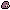 Barnaclejaw (item): 9076 -> **9514**
-  Crystalized Wheatfish (item): 9077 -> **9515**
-  Darter (item): 9078 -> **9516**
-  Shadow Darter (item): 9079 -> **9517**
-  Electric Eel (item): 9080 -> **9518**
-  Grass Snapper (item): 9081 -> **9519**
-  Jungle Spinefish (item): 9082 -> **9520**
-  Mangler Catfish (item): 9083 -> **9521**
-  Mossback Arapaima (item): 9084 -> **9522**
-  Sandbelly Piranha (item): 9085 -> **9523**
-  Shadeback Ray (item): 9086 -> **9524**
-  Mudbelly Tilapia (item): 9087 -> **9525**
-  Mireback Carp (item): 9088 -> **9526**
-  Rotslab Eel (item): 9089 -> **9527**
-  Aether Minnow (item): 9090 -> **9528**
-  Murkborne Ray (item): 9091 -> **9529**
-  Eldertide Leviathan (item): 9092 -> **9530**
- 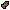 Oarfish (item): 9093 -> **9531**
-  Alpha Moon Strongfish (item): 9094 -> **9532**
-  Bamboo Catfish (item): 9095 -> **9533**
-  Blackwater Bream (item): 9096 -> **9534**
-  Blackwater Leviathan (item): 9097 -> **9535**
-  Boned Sturgeon (item): 9098 -> **9536**
-  Bull Shark (item): 9099 -> **9537**
-  Channel Sawfish (item): 9100 -> **9538**
-  Coastal Mullet (item): 9101 -> **9539**
-  Coelacanth (item): 9102 -> **9540**
-  Driftwood Catfish (item): 9103 -> **9541**
-  Eagle Ray (item): 9104 -> **9542**
-  Giant Grouper (item): 9105 -> **9543**
-  Giant Moray (item): 9106 -> **9544**
-  Giant Stingray (item): 9107 -> **9545**
-  Golden Mahseer (item): 9108 -> **9546**
-  Greenfin Loach (item): 9109 -> **9547**
-  Mangrove Herring (item): 9110 -> **9548**
-  Moonlit Boomerang Fish (item): 9111 -> **9549**
-  Moonstone Pupfish (item): 9112 -> **9550**
-  Mudline Perch (item): 9113 -> **9551**
-  Murk Stingray (item): 9114 -> **9552**
-  Needlefish (item): 9115 -> **9553**
-  Nomai Moray (item): 9116 -> **9554**
-  Pearlescent Moonfish (item): 9117 -> **9555**
-  Rainbow Guppy (item): 9118 -> **9556**
-  Red Snapper (item): 9119 -> **9557**
-  Reedglass Minnow (item): 9120 -> **9558**
-  Reef Sardine (item): 9121 -> **9559**
-  Root Perch (item): 9122 -> **9560**
-  Rust Scad (item): 9123 -> **9561**
-  Seahorse (item): 9124 -> **9562**
-  Snakehead (item): 9125 -> **9563**
-  Spined Stickleback (item): 9126 -> **9564**
-  Stone Grouper (item): 9127 -> **9565**
-  Sumpback Carp (item): 9128 -> **9566**
-  Sunset Minnow (item): 9129 -> **9567**
-  Tarpon (item): 9130 -> **9568**
-  Threadfin Bream (item): 9131 -> **9569**
-  Tri-Pointed Needlefish (item): 9132 -> **9570**
-  Game Dev Fish (item): 9133 -> **9571**
-  Armoured Searobin (item): 9134 -> **9572**
-  Ash Lionfish (item): 9135 -> **9573**
-  Barefrost Toothfish (item): 9136 -> **9574**
-  Blackfin Icefish (item): 9137 -> **9575**
-  Basalt Pipefish (item): 9138 -> **9576**
-  Brimstone Spikefish (item): 9139 -> **9577**
-  Cinder Leviathan (item): 9140 -> **9578**
-  Crowned Flame Angelfish (item): 9141 -> **9579**
-  Deepwater Lanternfish (item): 9142 -> **9580**
-  Driftice Capelin (item): 9143 -> **9581**
-  Ember Chub (item): 9144 -> **9582**
-  Embermark Wrasse (item): 9145 -> **9583**
-  Eviota Vader (item): 9146 -> **9584**
-  Frost Herring (item): 9147 -> **9585**
-  Frost Wolf Eel (item): 9148 -> **9586**
-  Frostpaint Notie (item): 9149 -> **9587**
-  Frozen Grenadier (item): 9150 -> **9588**
-  Giant Trevally (item): 9151 -> **9589**
-  Glacial Lanternfish (item): 9152 -> **9590**
-  Glacial Silverfish (item): 9153 -> **9591**
-  Heatwarp Flounder (item): 9154 -> **9592**
-  Hatchetfish (item): 9155 -> **9593**
-  Ice Spined Notothenia (item): 9156 -> **9594**
-  Iceshelf Skate (item): 9157 -> **9595**
-  Icy Sculpin (item): 9158 -> **9596**
-  Lavaflow Trout (item): 9159 -> **9597**
-  Lavawake Slopefish (item): 9160 -> **9598**
-  Magma Sardinella (item): 9161 -> **9599**
-  Magma Trout (item): 9162 -> **9600**
-  Marbled Moray Cod (item): 9163 -> **9601**
-  Molten Lotella Cod (item): 9164 -> **9602**
-  Northern Wolffish (item): 9165 -> **9603**
-  Paleice Rockcod (item): 9166 -> **9604**
-  Permafrost Halibut (item): 9167 -> **9605**
-  Pithead (item): 9168 -> **9606**
-  Polarflash Electron (item): 9169 -> **9607**
-  Pyroclast Eel (item): 9170 -> **9608**
-  Pyroscale Grouper (item): 9171 -> **9609**
-  Red Pyreside (item): 9172 -> **9610**
-  Rimesnouted Lancetfish (item): 9173 -> **9611**
-  Scorched Sunfish (item): 9174 -> **9612**
-  Scored Dace (item): 9175 -> **9613**
-  Silver Dragonfish (item): 9176 -> **9614**
-  Snow Haddock (item): 9177 -> **9615**
-  Volcanic Catfish (item): 9178 -> **9616**
-  Volcanic Semperi (item): 9179 -> **9617**
-  Rusty Rod (item): 9180 -> **9618**
-  Lucky Rod (item): 9181 -> **9619**
-  Sturdy Rod (item): 9182 -> **9620**
-  Jungle Rod (item): 9183 -> **9621**
-  Draugr Rod (item): 9184 -> **9622**
-  Cursed Rod (item): 9185 -> **9623**
-  Tangle Resistant Rod (item): 9186 -> **9624**
-  Speed Rod (item): 9187 -> **9625**
-  Carbon Rod (item): 9188 -> **9626**
-  Deep Sea Rod (item): 9189 -> **9627**
-  Master Rod (item): 9190 -> **9628**
-  Obsidian Rod (item): 9191 -> **9629**
-  Molten Magma Rod (item): 9192 -> **9630**
-  Frost Rod (item): 9193 -> **9631**
-  Black Ice Rod (item): 9194 -> **9632**
-  Mythic Rod (item): 9195 -> **9633**
-  Acorn (item): 9196 -> **9634**
-  Acorn Jelly (item): 9197 -> **9635**
-  Cow's Milk (item): 9198 -> **9636**
-  Cheese (item): 9199 -> **9637**
-  Caught Fish (item): 9200 -> **9638**
-  Fish Fillet (item): 9201 -> **9639**
-  Meaty Bone (item): 9202 -> **9640**
-  Blinding Pebble (item): 9203 -> **9641**
-  Sheep's Milk (item): 9204 -> **9642**
-  Yoghurt Pot (item): 9205 -> **9643**
- 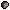 Truffle (item): 9206 -> **9644**
-  Truffle Oil (item): 9207 -> **9645**
-  Oats (item): 9208 -> **9646**
-  Porridge (item): 9209 -> **9647**
-  Dates (item): 9210 -> **9648**
-  Date Pudding (item): 9211 -> **9649**
-  Poop (item): 9212 -> **9650**
- 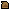 Fertiliser (item): 9213 -> **9651**
-  Medkit (item): 9214 -> **9652**
-  Wood Spear (item): 9215 -> **9653**
-  Stone Spear (item): 9216 -> **9654**
-  Iron Spear (item): 9217 -> **9655**
-  Gold Spear (item): 9218 -> **9656**
-  Diamond Spear (item): 9219 -> **9657**
-  Moonstone Spear (item): 9220 -> **9658**
-  Wood Dagger (item): 9221 -> **9659**
-  Stone Dagger (item): 9222 -> **9660**
-  Iron Dagger (item): 9223 -> **9661**
-  Gold Dagger (item): 9224 -> **9662**
-  Diamond Dagger (item): 9225 -> **9663**
-  Moonstone Dagger (item): 9226 -> **9664**
-  Wood Boomerang (item): 9227 -> **9665**
-  Stone Boomerang (item): 9228 -> **9666**
-  Iron Boomerang (item): 9229 -> **9667**
-  Gold Boomerang (item): 9230 -> **9668**
-  Diamond Boomerang (item): 9231 -> **9669**
-  Moonstone Boomerang (item): 9232 -> **9670**
-  Wood Club (item): 9233 -> **9671**
-  Stone Club (item): 9234 -> **9672**
-  Iron Club (item): 9235 -> **9673**
-  Gold Club (item): 9236 -> **9674**
-  Diamond Club (item): 9237 -> **9675**
-  Moonstone Club (item): 9238 -> **9676**
-  Wood Mace (item): 9239 -> **9677**
-  Stone Mace (item): 9240 -> **9678**
-  Iron Mace (item): 9241 -> **9679**
-  Gold Mace (item): 9242 -> **9680**
-  Diamond Mace (item): 9243 -> **9681**
-  Moonstone Mace (item): 9244 -> **9682**
-  Wood Whip (item): 9245 -> **9683**
-  Stone Whip (item): 9246 -> **9684**
-  Iron Whip (item): 9247 -> **9685**
-  Gold Whip (item): 9248 -> **9686**
-  Diamond Whip (item): 9249 -> **9687**
-  Moonstone Whip (item): 9250 -> **9688**
-  Beef Stew (item): 9251 -> **9689**
-  Chicken (item): 9252 -> **9690**
-  Coleslaw (item): 9253 -> **9691**
-  Egg (item): 9254 -> **9692**
-  Fish N Chips (item): 9255 -> **9693**
-  Fried Rice (item): 9256 -> **9694**
-  Lettuce (item): 9257 -> **9695**
-  Omelette (item): 9258 -> **9696**
-  Onion (item): 9259 -> **9697**
-  Red Cabbage (item): 9260 -> **9698**
-  Roast Dinner (item): 9261 -> **9699**
-  Salad (item): 9262 -> **9700**
-  Stuffed Pepper (item): 9263 -> **9701**
-  Sushi (item): 9264 -> **9702**
-  Tomato (item): 9265 -> **9703**
-  Vegetable Soup (item): 9266 -> **9704**
-  Common Lottery Ticket (item): 9267 -> **9705**
-  Uncommon Lottery Ticket (item): 9268 -> **9706**
-  Rare Lottery Ticket (item): 9269 -> **9707**
-  Epic Lottery Ticket (item): 9270 -> **9708**
-  Legendary Lottery Ticket (item): 9271 -> **9709**
-  Wood Clock (item): 9272 -> **9710**
-  Wood Clock|meta|midnight (item): 9273 -> **9711**
-  Wood Clock|meta|late_night (item): 9274 -> **9712**
-  Wood Clock|meta|sunrise (item): 9275 -> **9713**
-  Wood Clock|meta|early_day (item): 9276 -> **9714**
-  Wood Clock|meta|late_day (item): 9277 -> **9715**
-  Wood Clock|meta|sunset (item): 9278 -> **9716**
-  Wood Clock|meta|early_night (item): 9279 -> **9717**
-  Gold Clock (item): 9280 -> **9718**
-  Gold Clock|meta|midnight (item): 9281 -> **9719**
-  Gold Clock|meta|late_night (item): 9282 -> **9720**
-  Gold Clock|meta|sunrise (item): 9283 -> **9721**
-  Gold Clock|meta|early_day (item): 9284 -> **9722**
-  Gold Clock|meta|late_day (item): 9285 -> **9723**
-  Gold Clock|meta|sunset (item): 9286 -> **9724**
-  Gold Clock|meta|early_night (item): 9287 -> **9725**
-  Lucky Sword Upgrade (item): 9288 -> **9726**
-  Lucky Armour Upgrade (item): 9289 -> **9727**
-  Lucky Tools Upgrade (item): 9290 -> **9728**
-  Lucky Clover (item): 9291 -> **9729**
-  Void Net (item): 9292 -> **9730**
-  Lucky Bomb (item): 9293 -> **9731**
-  Unlucky Bomb (item): 9294 -> **9732**
-  Swap Orb (item): 9295 -> **9733**
-  Golden Lucky Clover (item): 9296 -> **9734**
-  Amethite (item): 9297 -> **9735**
-  Amethite Fragment (item): 9298 -> **9736**
-  Amethite Pickaxe (item): 9299 -> **9737**
-  Amethite Axe (item): 9300 -> **9738**
-  Amethite Spade (item): 9301 -> **9739**
-  Amethite Sword (item): 9302 -> **9740**
-  Amethite Hoe (item): 9303 -> **9741**
-  Amethite Helmet (item): 9304 -> **9742**
-  Amethite Chestplate (item): 9305 -> **9743**
-  Amethite Leggings (item): 9306 -> **9744**
-  Amethite Boots (item): 9307 -> **9745**
-  Amethite Gauntlets (item): 9308 -> **9746**
-  Amethite Bow (item): 9309 -> **9747**
-  Amethite Bow|meta|charging2 (item): 9310 -> **9748**
-  Amethite Bow|meta|charging3 (item): 9311 -> **9749**
-  Amethite Bow|meta|charging4 (item): 9312 -> **9750**
-  Amethite Crossbow (item): 9313 -> **9751**
-  Amethite Crossbow|meta|charging2 (item): 9314 -> **9752**
-  Amethite Crossbow|meta|charging3 (item): 9315 -> **9753**
-  Amethite Crossbow|meta|charging4 (item): 9316 -> **9754**
-  Amethite Crossbow Charged (item): 9317 -> **9755**
-  Amethite Spear (item): 9318 -> **9756**
-  Amethite Dagger (item): 9319 -> **9757**
-  Amethite Boomerang (item): 9320 -> **9758**
-  Amethite Club (item): 9321 -> **9759**
-  Amethite Mace (item): 9322 -> **9760**
-  Amethite Whip (item): 9323 -> **9761**
-  Magmasteel (item): 9324 -> **9762**
-  Magmasteel Fragment (item): 9325 -> **9763**
-  Magmasteel Pickaxe (item): 9326 -> **9764**
-  Magmasteel Axe (item): 9327 -> **9765**
-  Magmasteel Spade (item): 9328 -> **9766**
-  Magmasteel Sword (item): 9329 -> **9767**
-  Magmasteel Hoe (item): 9330 -> **9768**
-  Magmasteel Helmet (item): 9331 -> **9769**
-  Magmasteel Chestplate (item): 9332 -> **9770**
-  Magmasteel Leggings (item): 9333 -> **9771**
-  Magmasteel Boots (item): 9334 -> **9772**
-  Magmasteel Gauntlets (item): 9335 -> **9773**
-  Magmasteel Bow (item): 9336 -> **9774**
-  Magmasteel Bow|meta|charging2 (item): 9337 -> **9775**
-  Magmasteel Bow|meta|charging3 (item): 9338 -> **9776**
-  Magmasteel Bow|meta|charging4 (item): 9339 -> **9777**
-  Magmasteel Crossbow (item): 9340 -> **9778**
-  Magmasteel Crossbow|meta|charging2 (item): 9341 -> **9779**
-  Magmasteel Crossbow|meta|charging3 (item): 9342 -> **9780**
-  Magmasteel Crossbow|meta|charging4 (item): 9343 -> **9781**
-  Magmasteel Crossbow Charged (item): 9344 -> **9782**
-  Magmasteel Spear (item): 9345 -> **9783**
-  Magmasteel Dagger (item): 9346 -> **9784**
-  Magmasteel Boomerang (item): 9347 -> **9785**
-  Magmasteel Club (item): 9348 -> **9786**
-  Magmasteel Mace (item): 9349 -> **9787**
-  Magmasteel Whip (item): 9350 -> **9788**
-  Rubellite (item): 9351 -> **9789**
-  Rubellite Fragment (item): 9352 -> **9790**
-  Rubellite Pickaxe (item): 9353 -> **9791**
-  Rubellite Axe (item): 9354 -> **9792**
-  Rubellite Spade (item): 9355 -> **9793**
-  Rubellite Sword (item): 9356 -> **9794**
-  Rubellite Hoe (item): 9357 -> **9795**
-  Rubellite Helmet (item): 9358 -> **9796**
-  Rubellite Chestplate (item): 9359 -> **9797**
-  Rubellite Leggings (item): 9360 -> **9798**
-  Rubellite Boots (item): 9361 -> **9799**
-  Rubellite Gauntlets (item): 9362 -> **9800**
-  Rubellite Bow (item): 9363 -> **9801**
-  Rubellite Bow|meta|charging2 (item): 9364 -> **9802**
-  Rubellite Bow|meta|charging3 (item): 9365 -> **9803**
-  Rubellite Bow|meta|charging4 (item): 9366 -> **9804**
-  Rubellite Crossbow (item): 9367 -> **9805**
-  Rubellite Crossbow|meta|charging2 (item): 9368 -> **9806**
-  Rubellite Crossbow|meta|charging3 (item): 9369 -> **9807**
-  Rubellite Crossbow|meta|charging4 (item): 9370 -> **9808**
-  Rubellite Crossbow Charged (item): 9371 -> **9809**
-  Rubellite Spear (item): 9372 -> **9810**
-  Rubellite Dagger (item): 9373 -> **9811**
-  Rubellite Boomerang (item): 9374 -> **9812**
-  Rubellite Club (item): 9375 -> **9813**
-  Rubellite Mace (item): 9376 -> **9814**
-  Rubellite Whip (item): 9377 -> **9815**
-  Serpentite (item): 9378 -> **9816**
-  Serpentite Fragment (item): 9379 -> **9817**
-  Serpentite Pickaxe (item): 9380 -> **9818**
-  Serpentite Axe (item): 9381 -> **9819**
-  Serpentite Spade (item): 9382 -> **9820**
-  Serpentite Sword (item): 9383 -> **9821**
-  Serpentite Hoe (item): 9384 -> **9822**
-  Serpentite Helmet (item): 9385 -> **9823**
-  Serpentite Chestplate (item): 9386 -> **9824**
-  Serpentite Leggings (item): 9387 -> **9825**
-  Serpentite Boots (item): 9388 -> **9826**
-  Serpentite Gauntlets (item): 9389 -> **9827**
-  Serpentite Bow (item): 9390 -> **9828**
-  Serpentite Bow|meta|charging2 (item): 9391 -> **9829**
-  Serpentite Bow|meta|charging3 (item): 9392 -> **9830**
-  Serpentite Bow|meta|charging4 (item): 9393 -> **9831**
-  Serpentite Crossbow (item): 9394 -> **9832**
-  Serpentite Crossbow|meta|charging2 (item): 9395 -> **9833**
-  Serpentite Crossbow|meta|charging3 (item): 9396 -> **9834**
-  Serpentite Crossbow|meta|charging4 (item): 9397 -> **9835**
-  Serpentite Crossbow Charged (item): 9398 -> **9836**
-  Serpentite Spear (item): 9399 -> **9837**
-  Serpentite Dagger (item): 9400 -> **9838**
-  Serpentite Boomerang (item): 9401 -> **9839**
-  Serpentite Club (item): 9402 -> **9840**
-  Serpentite Mace (item): 9403 -> **9841**
-  Serpentite Whip (item): 9404 -> **9842**
-  Cursemetal Helmet (item): 9405 -> **9843**
-  Cursemetal Chestplate (item): 9406 -> **9844**
-  Cursemetal Gauntlets (item): 9407 -> **9845**
-  Cursemetal Leggings (item): 9408 -> **9846**
-  Cursemetal Boots (item): 9409 -> **9847**
-  Kingly Amethite Helmet (item): 9410 -> **9848**
-  Kingly Amethite Chestplate (item): 9411 -> **9849**
-  Kingly Amethite Gauntlets (item): 9412 -> **9850**
-  Kingly Amethite Leggings (item): 9413 -> **9851**
-  Kingly Amethite Boots (item): 9414 -> **9852**
-  Kingly Diamond Helmet (item): 9415 -> **9853**
-  Kingly Diamond Chestplate (item): 9416 -> **9854**
-  Kingly Diamond Gauntlets (item): 9417 -> **9855**
-  Kingly Diamond Leggings (item): 9418 -> **9856**
-  Kingly Diamond Boots (item): 9419 -> **9857**
-  Sanguine Shard (item): 9420 -> **9858**
-  Sanguine Sword (item): 9421 -> **9859**
-  Sanguine Bow (item): 9422 -> **9860**
-  Sanguine Bow|meta|charging2 (item): 9423 -> **9861**
-  Sanguine Bow|meta|charging3 (item): 9424 -> **9862**
-  Sanguine Bow|meta|charging4 (item): 9425 -> **9863**
-  Sanguine Crossbow (item): 9426 -> **9864**
-  Sanguine Crossbow|meta|charging2 (item): 9427 -> **9865**
-  Sanguine Crossbow|meta|charging3 (item): 9428 -> **9866**
-  Sanguine Crossbow|meta|charging4 (item): 9429 -> **9867**
-  Sanguine Crossbow Charged (item): 9430 -> **9868**
-  Sanguine Spear (item): 9431 -> **9869**
-  Sanguine Dagger (item): 9432 -> **9870**
-  Sanguine Club (item): 9433 -> **9871**
-  Sanguine Mace (item): 9434 -> **9872**
-  Sanguine Whip (item): 9435 -> **9873**
-  Sanguine Staff (item): 9436 -> **9874**
-  Sanguine Helmet (item): 9437 -> **9875**
-  Sanguine Chestplate (item): 9438 -> **9876**
-  Sanguine Gauntlets (item): 9439 -> **9877**
-  Sanguine Leggings (item): 9440 -> **9878**
-  Sanguine Boots (item): 9441 -> **9879**
-  Spectral Shard (item): 9442 -> **9880**
-  Spectral Sword (item): 9443 -> **9881**
-  Spectral Bow (item): 9444 -> **9882**
-  Spectral Bow|meta|charging2 (item): 9445 -> **9883**
-  Spectral Bow|meta|charging3 (item): 9446 -> **9884**
-  Spectral Bow|meta|charging4 (item): 9447 -> **9885**
-  Spectral Crossbow (item): 9448 -> **9886**
-  Spectral Crossbow|meta|charging2 (item): 9449 -> **9887**
-  Spectral Crossbow|meta|charging3 (item): 9450 -> **9888**
-  Spectral Crossbow|meta|charging4 (item): 9451 -> **9889**
-  Spectral Crossbow Charged (item): 9452 -> **9890**
-  Spectral Spear (item): 9453 -> **9891**
-  Spectral Dagger (item): 9454 -> **9892**
-  Spectral Club (item): 9455 -> **9893**
-  Spectral Mace (item): 9456 -> **9894**
-  Spectral Whip (item): 9457 -> **9895**
-  Spectral Staff (item): 9458 -> **9896**
-  Spectral Helmet (item): 9459 -> **9897**
-  Spectral Chestplate (item): 9460 -> **9898**
-  Spectral Gauntlets (item): 9461 -> **9899**
-  Spectral Leggings (item): 9462 -> **9900**
-  Spectral Boots (item): 9463 -> **9901**
-  Geo Shard (item): 9464 -> **9902**
-  Geo Sword (item): 9465 -> **9903**
-  Geo Bow (item): 9466 -> **9904**
-  Geo Bow|meta|charging2 (item): 9467 -> **9905**
-  Geo Bow|meta|charging3 (item): 9468 -> **9906**
-  Geo Bow|meta|charging4 (item): 9469 -> **9907**
-  Geo Crossbow (item): 9470 -> **9908**
-  Geo Crossbow|meta|charging2 (item): 9471 -> **9909**
-  Geo Crossbow|meta|charging3 (item): 9472 -> **9910**
-  Geo Crossbow|meta|charging4 (item): 9473 -> **9911**
-  Geo Crossbow Charged (item): 9474 -> **9912**
-  Geo Spear (item): 9475 -> **9913**
-  Geo Dagger (item): 9476 -> **9914**
-  Geo Club (item): 9477 -> **9915**
-  Geo Mace (item): 9478 -> **9916**
-  Geo Whip (item): 9479 -> **9917**
-  Geo Staff (item): 9480 -> **9918**
-  Geo Helmet (item): 9481 -> **9919**
-  Geo Chestplate (item): 9482 -> **9920**
-  Geo Gauntlets (item): 9483 -> **9921**
-  Geo Leggings (item): 9484 -> **9922**
-  Geo Boots (item): 9485 -> **9923**
-  Astral Shard (item): 9486 -> **9924**
-  Astral Sword (item): 9487 -> **9925**
-  Astral Bow (item): 9488 -> **9926**
-  Astral Bow|meta|charging2 (item): 9489 -> **9927**
-  Astral Bow|meta|charging3 (item): 9490 -> **9928**
-  Astral Bow|meta|charging4 (item): 9491 -> **9929**
-  Astral Crossbow (item): 9492 -> **9930**
-  Astral Crossbow|meta|charging2 (item): 9493 -> **9931**
-  Astral Crossbow|meta|charging3 (item): 9494 -> **9932**
-  Astral Crossbow|meta|charging4 (item): 9495 -> **9933**
-  Astral Crossbow Charged (item): 9496 -> **9934**
-  Astral Spear (item): 9497 -> **9935**
-  Astral Dagger (item): 9498 -> **9936**
-  Astral Club (item): 9499 -> **9937**
-  Astral Mace (item): 9500 -> **9938**
-  Astral Whip (item): 9501 -> **9939**
-  Astral Staff (item): 9502 -> **9940**
-  Astral Helmet (item): 9503 -> **9941**
-  Astral Chestplate (item): 9504 -> **9942**
-  Astral Gauntlets (item): 9505 -> **9943**
-  Astral Leggings (item): 9506 -> **9944**
-  Astral Boots (item): 9507 -> **9945**
-  Wooden Key (item): 9508 -> **9946**
-  Stone Key (item): 9509 -> **9947**
-  Iron Key (item): 9510 -> **9948**
-  Gold Key (item): 9511 -> **9949**
-  Diamond Key (item): 9512 -> **9950**
-  Cracked Rubellite Pickaxe (item): 9513 -> **9951**
-  Goldheart Engine (item): 9514 -> **9952**
-  Deepbite Drill Tip (item): 9515 -> **9953**
-  Empty Fuel Cell (item): 9516 -> **9954**
-  Blackfire Fuel Cell (item): 9517 -> **9955**
-  Doom Rivet (item): 9518 -> **9956**
-  Doom Crest (item): 9519 -> **9957**
-  Raw Copper (item): 9520 -> **9958**
-  Copper Bar (item): 9521 -> **9959**
-  Iron Grit (item): 9522 -> **9960**
-  Gold Grit (item): 9523 -> **9961**
-  Copper Grit (item): 9524 -> **9962**
-  Charcoal (item): 9525 -> **9963**
-  Recall Beacon (item): 9526 -> **9964**
-  Iron Hammer (item): 9527 -> **9965**
-  Iron Plate (item): 9528 -> **9966**
-  Copper Wire (item): 9529 -> **9967**
-  Motor (item): 9530 -> **9968**
-  Machine Parts (item): 9531 -> **9969**
-  Relay Coil (item): 9532 -> **9970**
-  Deposit Seed (Copper) (item): 9533 -> **9971**
-  Deposit Seed (Gold) (item): 9534 -> **9972**
-  Deposit Seed (Voltite) (item): 9535 -> **9973**
-  Deposit Seed (Coal) (item): 9536 -> **9974**
-  Deposit Seed (Iron) (item): 9537 -> **9975**
-  Deposit Seed (Stone) (item): 9538 -> **9976**
-  Steel Bar (item): 9539 -> **9977**
-  Gold Plate (item): 9540 -> **9978**
-  Logic Board (item): 9541 -> **9979**
-  Machine Hull (item): 9542 -> **9980**
-  Raw Voltite (item): 9543 -> **9981**
-  Power Coupler (item): 9544 -> **9982**
-  Ore Lens (item): 9545 -> **9983**
-  Homing Beacon (item): 9546 -> **9984**
-  Pull Charm (item): 9547 -> **9985**
-  Vein Breaker (item): 9548 -> **9986**
-  Voltite Dust (item): 9549 -> **9987**
-  Voltite Cell (item): 9550 -> **9988**
-  Sky Pack (item): 9551 -> **9989**
-  Dusk Moss (item): 9552 -> **9990**
-  Star Alloy (item): 9553 -> **9991**
-  Moonstone Dust (item): 9554 -> **9992**
-  Comet Shard (item): 9555 -> **9993**
-  Comet Core (item): 9556 -> **9994**
-  Starbore Drill (item): 9557 -> **9995**
-  Core Tier 2 (item): 9558 -> **9996**
-  Core Tier 3 (item): 9559 -> **9997**
-  Core Tier 4 (item): 9560 -> **9998**
-  Core Tier 5 (item): 9561 -> **9999**
-  Core Tier 6 (item): 9562 -> **10000**
-  Core Tier 7 (item): 9563 -> **10001**
-  Core Tier 8 (item): 9564 -> **10002**
-  Core Tier 9 (item): 9565 -> **10003**
-  Core Tier 10 (item): 9566 -> **10004**
-  Arc Caster (item): 9567 -> **10005**
-  Voltplate Helmet (item): 9568 -> **10006**
-  Voltplate Chestplate (item): 9569 -> **10007**
-  Voltplate Gauntlets (item): 9570 -> **10008**
-  Voltplate Leggings (item): 9571 -> **10009**
-  Voltplate Boots (item): 9572 -> **10010**
-  Wood Blade (item): 9573 -> **10011**
-  Wood Guard (item): 9574 -> **10012**
-  Wood Handle (item): 9575 -> **10013**
-  Stone Blade (item): 9576 -> **10014**
-  Stone Guard (item): 9577 -> **10015**
-  Stone Handle (item): 9578 -> **10016**
-  Iron Blade (item): 9579 -> **10017**
-  Iron Guard (item): 9580 -> **10018**
-  Iron Handle (item): 9581 -> **10019**
-  Gold Blade (item): 9582 -> **10020**
-  Gold Guard (item): 9583 -> **10021**
-  Gold Handle (item): 9584 -> **10022**
-  Diamond Blade (item): 9585 -> **10023**
-  Diamond Guard (item): 9586 -> **10024**
-  Diamond Handle (item): 9587 -> **10025**
-  Moonstone Blade (item): 9588 -> **10026**
-  Moonstone Guard (item): 9589 -> **10027**
-  Moonstone Handle (item): 9590 -> **10028**
-  Magmasteel Blade (item): 9591 -> **10029**
-  Magmasteel Guard (item): 9592 -> **10030**
-  Magmasteel Handle (item): 9593 -> **10031**
-  Sanguine Blade (item): 9594 -> **10032**
-  Sanguine Guard (item): 9595 -> **10033**
-  Sanguine Handle (item): 9596 -> **10034**
-  Astral Blade (item): 9597 -> **10035**
-  Astral Guard (item): 9598 -> **10036**
-  Astral Handle (item): 9599 -> **10037**
-  Moonstone Sword (item): 9600 -> **10038**
-  Magmaward Fuel (item): 9601 -> **10039**

Latest added/removed: [CHANGES.md](CHANGES.md)
ID changes from older updates: [HISTORY.md](HISTORY.md)
